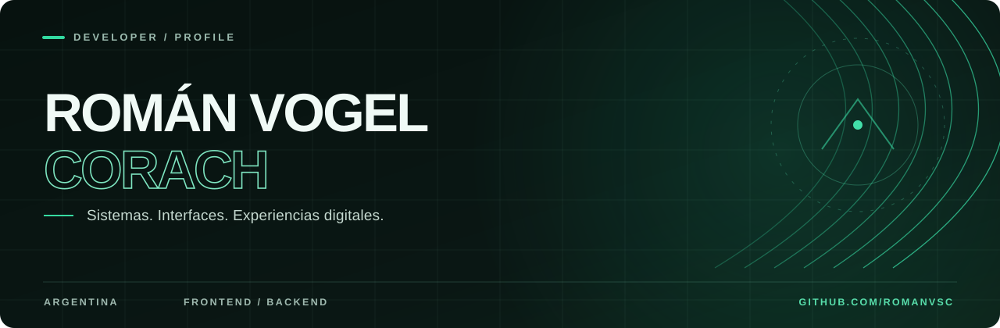

  

  

    
    
    
  

## Perfil

Estudio **Analista de Sistemas** y desarrollo soluciones digitales para necesidades concretas: desde sitios institucionales hasta herramientas de administración, producción y mantenimiento.

Me interesa tanto la arquitectura de un sistema como la experiencia de quien lo utiliza. Trabajo especialmente con **Vue, JavaScript, Python, PHP y bases de datos**, prestando atención a los detalles de interfaz y a la claridad de los procesos.

---

## 01 / Proyectos seleccionados

<table>
  <tr>
    <td width="50%" valign="top">
      SISTEMAS / EDUCACIÓN
      <h3><a href="https://github.com/romanvsc/IPAC">IPAC</a></h3>
      Gestión de alumnos, sucursales, tesorería y cobranzas. Una plataforma pensada para centralizar la operación administrativa.  
      <code>Django</code> <code>DRF</code> <code>Vue</code> <code>PostgreSQL</code>
    </td>
    <td width="50%" valign="top">
      SISTEMAS / OPERACIONES
      <h3><a href="https://github.com/romanvsc/mantenimiento">Mantenimiento de equipos</a></h3>
      Gestión de flotas y equipos, lecturas, planes preventivos y órdenes de trabajo.  
      <code>PHP</code> <code>CodeIgniter 4</code> <code>MySQL</code>
    </td>
  </tr>
  <tr>
    <td width="50%" valign="top">
      FULLSTACK / SECTOR FORESTAL
      <h3><a href="https://github.com/romanvsc/registro_produccion">Registro de Producción</a></h3>
      Registro y consulta de producción forestal, con métricas para seguimiento operativo.  
      <code>FastAPI</code> <code>Vue</code> <code>MySQL</code>
    </td>
    <td width="50%" valign="top">
      WEB APP / GESTIÓN
      <h3><a href="https://github.com/romanvsc/gestion_gimnasio">Gestión Gimnasio</a></h3>
      PWA para socios, pagos, asistencia, caja y reportes.  
      <code>Vue 3</code> <code>Supabase</code> <code>PWA</code>
    </td>
  </tr>
  <tr>
    <td width="50%" valign="top">
      WEB / IDENTIDAD CORPORATIVA
      <h3><a href="https://github.com/romanvsc/vogel_consultoria">Vogel Consultoría</a></h3>
      Experiencia web institucional para comunicar servicios, soluciones y proyectos.  
      <code>Vue 3</code> <code>Vite</code> <code>Tailwind CSS</code>
    </td>
    <td width="50%" valign="top">
      WEB / SECTOR FORESTAL
      <h3><a href="https://github.com/romanvsc/web-forestal">Forestal Garuhapé</a></h3>
      Sitio corporativo de servicios forestales, logística y consultoría.  
      <code>Eleventy</code> <code>Nunjucks</code> <code>Tailwind CSS</code>
    </td>
  </tr>
</table>

OTROS PROYECTOS

[Forestal Paraguay](https://github.com/romanvsc/web_fgpy) · [AN Asociados](https://github.com/romanvsc/web_anasociados) · [Ver repositorios](https://github.com/romanvsc?tab=repositories)

---

## 02 / Tecnologías

**Interfaces**

**Backend y datos**

**Herramientas**

---

## 03 / Enfoque

**Diseño de interfaces.** Estructura, jerarquía visual, responsividad y movimiento cuando aporta a la experiencia.

**Desarrollo de sistemas.** Modelado de procesos, gestión de datos, permisos y flujos operativos.

**Proyectos reales.** Trabajo con contextos donde el software tiene que simplificar tareas y acompañar decisiones.

---

  <a href="https://portfolio-roman-wheat.vercel.app/"><strong>PORTFOLIO</strong></a>
  &nbsp; / &nbsp;
  <a href="https://github.com/romanvsc?tab=repositories"><strong>REPOSITORIOS</strong></a>
  &nbsp; / &nbsp;
  <a href="mailto:romanvscprogramming@gmail.com"><strong>EMAIL</strong></a>
  
Román Vogel Corach — Argentina

